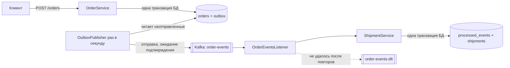

# Orders Outbox Demo

[English version](README.md)

Небольшой проект на Spring Boot 4 и Apache Kafka, который показывает, как доставлять события **надёжно**:
Transactional Outbox, идемпотентный консьюмер, повторы и Dead Letter Topic.
Это учебный проект с тестами и намеренными падениями процесса для проверки надёжности.

## Проблема

Сохранить заказ в базу данных и опубликовать событие в Kafka это две разные системы.
Общей транзакции у них нет, поэтому сбой между этими двумя шагами приводит к потере события.

## Решение



1. **Заказ и событие в одной транзакции.** `OrderService` вставляет заказ и запись в `outbox` вместе.
   Сохраняется либо всё, либо ничего.
2. **Публикатор.** `OutboxPublisher` читает неотправленные записи, отправляет их в Kafka (`acks=all`),
   ждёт подтверждения и только потом выставляет `sent_at`. Если процесс упал между этими шагами,
   после перезапуска событие уйдёт повторно: доставка **at-least-once**.
3. **Идемпотентный консьюмер.** `ShipmentService` записывает `eventId` в таблицу `processed_events`
   (первичный ключ) **в той же транзакции**, что и сама работа. Дубль упирается в уникальный ключ
   и пропускается.
4. **Ошибки.** Некорректный JSON или недопустимые данные сразу попадают в dead-letter topic.
   Временные сбои повторяются 3 раза с паузой в 1 секунду, затем тоже уходят в DLT.
   Причина ошибки сохраняется в заголовках сообщения.
5. **Порядок.** Ключ сообщения Kafka это идентификатор заказа, поэтому события одного заказа
   всегда попадают в одну партицию.

## Стек

Java 21, Spring Boot 4.1, Spring Kafka, Apache Kafka 4 (KRaft), JdbcTemplate, H2,
JUnit 5, AssertJ, Awaitility, Testcontainers.

## Запуск

Нужны Java 21 и Docker.

```bash
# Kafka
docker run -d --name kafka -p 9092:9092 apache/kafka:latest

# топики
docker exec kafka /opt/kafka/bin/kafka-topics.sh --bootstrap-server localhost:9092 \
  --create --topic order-events --partitions 3 --replication-factor 1
docker exec kafka /opt/kafka/bin/kafka-topics.sh --bootstrap-server localhost:9092 \
  --create --topic order-events-dlt --partitions 3 --replication-factor 1

# приложение
./mvnw spring-boot:run
```

Создай заказ и посмотри, как он проходит через систему:

```bash
curl -X POST localhost:8080/orders -H "Content-Type: application/json" \
  -d '{"customer":"Ivan","amount":100}'

curl localhost:8080/debug/orders
curl localhost:8080/debug/outbox       # sent_at заполняется, когда событие опубликовано
curl localhost:8080/debug/shipments
curl localhost:8080/debug/processed
```

Попробуй некорректные данные: `{"customer":"Neg","amount":-5}` сразу попадёт в `order-events-dlt`,
а `{"customer":"broken","amount":100}` будет повторён 3 раза и тоже окажется там.

## Тесты

```bash
./mvnw test
```

| Класс | Что доказывает | Нужен Docker |
|---|---|---|
| `OrderServiceTest` | заказ и запись в outbox сохраняются вместе, при сбое откатываются обе | нет |
| `ShipmentServiceTest` | дубль события создаёт одну отгрузку, неудачная обработка не оставляет следа в журнале | нет |
| `OrderFlowIntegrationTest` | весь путь через настоящую Kafka (Testcontainers): доставка, дубль, ядовитое сообщение в DLT | да |

## Эксперименты с падениями

Два переключателя имитируют жёсткое падение процесса (`Runtime.halt`, как `kill -9`):

| Свойство | Где падает | Ожидаемый результат после перезапуска |
|---|---|---|
| `chaos.crash-after-send=true` | публикатор: Kafka приняла событие, но `sent_at` ещё не выставлен | событие публикуется дважды, консьюмер пропускает дубль, отгрузка одна |
| `chaos.crash-mid-handle=true` | консьюмер: запись в журнал сделана, отгрузка ещё нет | транзакция откатывается, событие обрабатывается заново, отгрузка одна |

Без общей транзакции в `ShipmentService` второй случай молча теряет отгрузку:
журнал говорит «обработано», а работа так и не была выполнена.

## Ограничения и что можно улучшить

- Только один экземпляр публикатора. Для нескольких нужен `SELECT ... FOR UPDATE SKIP LOCKED`.
- H2 вместо PostgreSQL (код написан на обычном SQL, меняется только источник данных).
- Опрос таблицы вместо CDC (Debezium читал бы outbox из журнала базы данных).
- Нет очистки старых записей outbox и инструмента повторной отправки из dead-letter topic.
- Повторы блокирующие: упавшая запись приостанавливает свою партицию. Это сохраняет порядок.
- Debug-эндпоинты и переключатели хаоса нужны только для демонстрации.
